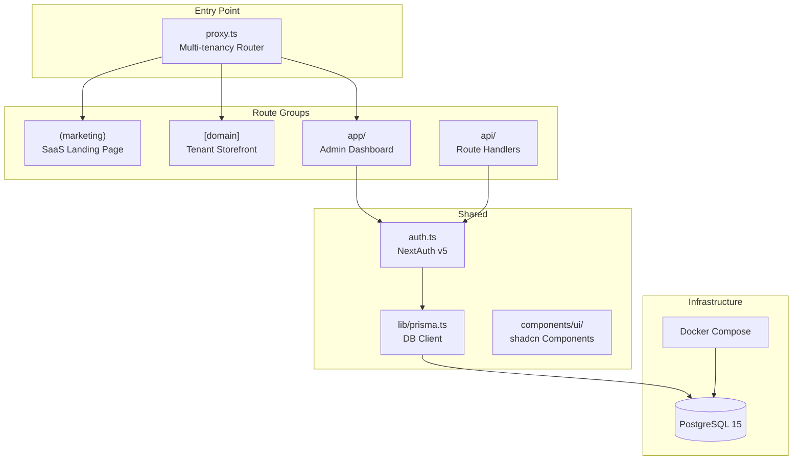

# Architecture

**Pattern:** Multi-tenant SaaS monolith (Next.js App Router)

## High-Level Structure



## Identified Patterns

### Multi-Tenancy via Middleware Rewriting

**Location:** `src/proxy.ts`
**Purpose:** Route requests to the correct app surface based on hostname (subdomain).
**Implementation:** The middleware intercepts all non-API/static requests and rewrites them:
- `app.localhost:3000` → `/app/*` (admin dashboard)
- `localhost:3000` (root) → `/(marketing)/*` (SaaS landing)
- `*.localhost:3000` → `/[domain]/*` (dynamic tenant storefront)

**Example:** A request to `loja1.localhost:3000/` is rewritten to `/loja1/` which maps to `src/app/[domain]/page.tsx`.

### Prisma Singleton (Dev HMR Safe)

**Location:** `src/lib/prisma.ts`
**Purpose:** Prevent multiple Prisma Client instances during hot module reload in development.
**Implementation:** Stores the client on `globalThis` in non-production environments.

### JWT-Based Auth with Role Extension

**Location:** `src/auth.ts`, `src/types/next-auth.d.ts`
**Purpose:** Authentication with role-based access control.
**Implementation:** Extends NextAuth's JWT and Session types with a `role` field. Currently uses a mock Credentials provider (POC). PrismaAdapter is configured but auth flow is hardcoded.

### shadcn/ui Component Pattern

**Location:** `src/components/ui/`
**Purpose:** Reusable, accessible UI primitives.
**Implementation:** Components installed via `shadcn` CLI using `base-nova` style. Uses CVA for variants. All components use the `cn()` utility for className merging.

## Data Flow

### Tenant Storefront Rendering

```
Request (loja1.localhost:3000)
  → proxy.ts: extract hostname, rewrite to /loja1/
  → [domain]/layout.tsx: mobile-first shell (max-w-md)
  → [domain]/page.tsx: render product catalog (currently mocked)
  → WhatsApp CTA button: direct conversion
```

### Admin Dashboard Access

```
Request (app.localhost:3000)
  → proxy.ts: rewrite to /app/
  → app/layout.tsx: sidebar layout (desktop + mobile sheet)
  → app/dashboard/page.tsx: overview cards (mocked data)
  → app/dashboard/products/page.tsx: empty state + AI generation CTA
```

### Authentication Flow

```
NextAuth route handler (api/auth/[...nextauth]/route.ts)
  → exports GET/POST from auth.ts handlers
  → CredentialsProvider: mock authorize (admin@boxshop.com / admin)
  → JWT callback: inject role into token
  → Session callback: inject role into session
```

## Code Organization

**Approach:** Route-group-based separation by audience/surface.

**Structure:**
- `(marketing)` — Public SaaS marketing pages (route group, no URL prefix)
- `[domain]` — Dynamic tenant storefront (catch-all by subdomain)
- `app/` — Authenticated admin dashboard
- `api/` — Backend route handlers

**Module boundaries:**
- Each route group is self-contained with its own layout
- Shared UI lives in `src/components/ui/`
- Shared utilities in `src/lib/`
- Auth configuration is centralized in `src/auth.ts`
- Database schema is in `prisma/schema.prisma` (3 models: Tenant, User, Product)
